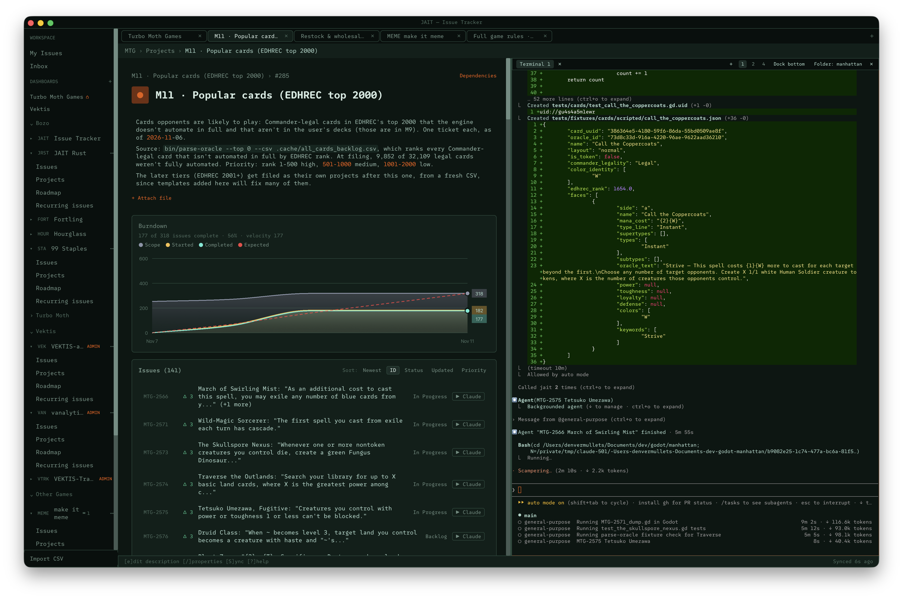

# JAIT Desktop

A native macOS client for [JAIT](https://justanotherissuetracker.com) (Just Another Issue Tracker). It keeps a full local copy of your teams, so it opens instantly, works offline, and syncs both ways with the JAIT web app. It also has built-in terminals tied to teams and projects, so the issue you're working on and the shell you're working in sit in the same window.




## Why a desktop app

The web app is the system of record. The desktop app is for the person who lives in the tracker all day:

- **Fast.** Every screen reads from a local SQLite database, not the network, so moving between boards, issues and projects doesn't wait on a server.
- **Works offline.** Edits made without a connection are queued and sent when you're back online. Nothing is lost if the server is down or your access changes mid-edit.
- **Keyboard first.** Most actions have a single-key shortcut that matches the web app, plus a Cmd+K command palette to jump anywhere.
- **Work next to your tickets.** Each team and project gets its own terminals, so an agent session, dev server or checkout stays with the work it belongs to. A "▶ Claude" button on an issue types a ready-made prompt for it into your terminal.

## What it does

It covers nearly everything the web app does. Highlights by area:

| Area | What's there |
|---|---|
| **Issues** | Board and list views, issue detail, labels, priorities, assignees, due dates, threaded comments with @mentions and `#` issue links, Markdown with syntax-highlighted code, attachments and pasted images |
| **Structure** | Sub-issues to any depth, blocking / relates-to / duplicate links, dependency maps for an issue or a whole project, dependency lines drawn on the board |
| **Projects** | Project list and detail pages, burndown charts, roadmap (Now / Next / Later), project comments |
| **Views** | Per-team filters and display options, saved views, cross-team My Issues, dashboards built from teams / projects / labels, a Home page that opens at launch |
| **Staying current** | Inbox with unread badge, native macOS notification banners, hover cards that preview an issue, project or person |
| **Workspace** | Tabs for teams, projects and cross-team pages (restored on relaunch), built-in terminals per team or project, themes, fonts, window translucency |
| **Admin** | Team, lane and label management, recurring issues, CSV import / export |

Saved views, dashboards, the Home page and sidebar groups are stored on the server, so they look the same on the desktop and the web.

See [CHANGELOG.md](CHANGELOG.md) for what shipped when.

## How it works

```
 ┌───────────────────────────┐        ┌──────────────────────┐
 │  Desktop app (Rust/Iced)  │        │  JAIT Rails app      │
 │                           │  HTTPS │                      │
 │  UI ── local SQLite ──────┼───────►│  JSON API (/api/v1)  │
 │          ▲     │          │◄───────┼                      │
 │          │     ▼          │        └──────────────────────┘
 │        sync queue         │
 └───────────────────────────┘
```

- **Local first.** The UI only ever reads and writes the local database. Every edit is saved locally right away and added to a sync queue.
- **Data sync** runs in the background: it pushes queued edits, then pulls only what changed since the last sync (plus a feed of deletions). It runs more often while you're active and backs off when the app is idle, unfocused, or the server is failing.
- **Notification poll** is a separate, lighter check that keeps the Inbox current between data syncs.
- **Conflicts.** Your unsynced edits aren't overwritten by incoming data, and they show as *pending* in an issue's activity until the server confirms them.
- **Auth** is a personal API token entered in Settings. A read-only token works; the app shows a banner and keeps your edits local.
- **Terminals are local only.** Their contents never reach the server.

## Status

Version 0.8.0, in active daily use. macOS on Apple Silicon only; the signed and notarized build ships as a DMG. The server side lives in a separate Rails repo; when the desktop needs a new API, that work is ticketed on the Rails team rather than changed from here.

## Running it

Toolchains are managed with [mise](https://mise.jdx.dev). The terminal engine needs an exact Zig version to build.

```sh
mise install                 # once per checkout
mise exec -- cargo run       # dev build, talks to a local Rails server on :3005
```

A dev build and a release build use separate servers and separate data folders, so dev edits never reach production. Release bundling, signing and notarizing are covered in [docs/desktop-run-notes.md](docs/desktop-run-notes.md).

## Further reading

- [GLOSSARY.md](GLOSSARY.md): the product vocabulary (Tab, Saved view, Dashboard, Terminal states, and so on)
- [docs/adr/](docs/adr/): architecture decisions and why they were made
- [docs/rails-api.md](docs/rails-api.md): the server API the app syncs against
- [docs/desktop-run-notes.md](docs/desktop-run-notes.md): dev setup, builds and releases
